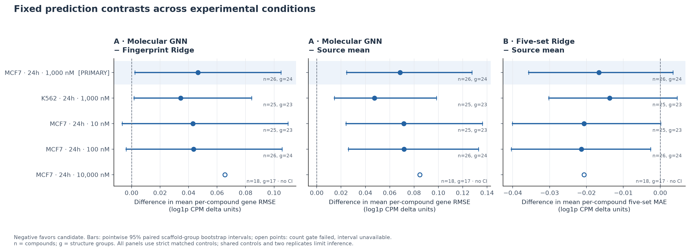
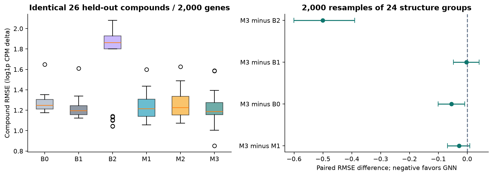

# DrugPerturb

[](https://github.com/NingyuSUN/drugperturb/actions/workflows/ci.yml)

**A reproducible benchmark for predicting compound-induced transcriptional responses from chemical structure.**

Public sci-Plex3 data · structure-based models · held-out compounds · cross-cell and cross-dose evaluation

[Cross-condition results](reports/v2/report.md) · [中文报告](reports/v2/report.zh-CN.md) · [v2 methods](docs/V2_METHODS.md) · [v2 reproducibility](docs/V2_REPRODUCIBILITY.md) · [Original A549 report](reports/report.html)

To view the original v1 HTML reports, clone this repository or choose **Code → Download ZIP** on GitHub and extract the complete archive. Keep the repository directory structure, then open `reports/report.html` or `reports/biologist_summary.html` in a browser. The full report loads figures and linked evidence from adjacent repository directories; downloading an HTML file alone will leave those resources unavailable. Viewing the reports does not require installing the analysis environment.

## Cross-condition results

**Models trained on A549 did not outperform zero-change predictions in any of the five evaluated target conditions.** The primary test is MCF7 at 24 hours and 1 µM, with **26 held-out compounds in 24 structure groups**. Original splits, gene outputs and predictions were frozen before scoring the new conditions.

| Primary MCF7 endpoint ↓ | Zero change | Source mean | Fingerprint Ridge | Molecular GNN |
|---|---:|---:|---:|---:|
| 2,000-gene mean compound RMSE | **0.53251** | 0.65132 | 0.67322 | 0.71975 |
| Five-set mean compound MAE | **0.08467** | 0.15744 | 0.14081 | Not fitted for this endpoint |

The five-set row uses a **separately trained Ridge head**, selected from four fixed candidates using only the source validation set. All five predefined sets passed training-only coverage checks. Its primary error difference from the source mean was −0.01664, with a 95% paired structure-group interval of [−0.03569, +0.00345]; a reliable gain was not established. These two rows have different output spaces and error definitions and should not be compared numerically.

For gene-level transport, GNN error exceeded Ridge by +0.04654 [95% interval +0.00235, +0.10479]. These are pointwise intervals conditional on the frozen models. Zero-change had the lowest mean error for both endpoints across all five conditions; this does **not** imply that the drugs have no biological effects.



The evaluation adds K562 at 1 µM and MCF7 at 10 nM, 100 nM and 10 µM. Eligible cohorts contain 18–26 compounds; the 10 µM cohort fails the prespecified sample-count gate and is reported descriptively without an interval. Matched-control sensitivity uses identical compound subsets. LINCS Phase I had **0/26 test compounds** under the exact independent-study condition, so no external expression-performance claim is made.

Read the [English](reports/v2/report.md) or [Chinese](reports/v2/report.zh-CN.md) report for every baseline, biological readout, denominator and limitation. The [scoring replay](receipts/v2_scoring_replay.json) reproduced all six scientific result files exactly using the same sealed inputs; it does not establish fresh extraction or retraining equivalence.

## Original A549 results (v1)

The molecular graph model achieved the lowest primary point estimate, but **a reliable advantage over strong simple baselines was not established**.

| Method | Held-out mean compound RMSE ↓ |
|---|---:|
| Zero change |1.2694|
| Training mean |1.2170|
| Chemical nearest neighbor |1.7149|
| Fingerprint Ridge |1.2430|
| Fingerprint MLP |1.2532|
| Molecular GNN, three-seed mean |**1.2144**|

All methods predict the same 2,000 genes for the same **26 held-out compounds**. The GNN–Ridge error difference is −0.0286, with a paired 95% structure-group interval of [−0.0680, +0.0087]. Its difference from the training mean is −0.0026 [−0.0475, +0.0419]. Both intervals include zero.

The control definition matters: using the average of two separately normalized same-plate vehicle wells changes the point-estimate ranking in favor of zero-change and training-mean references. GNN also has higher error than Ridge in all three exploratory development folds. These findings are retained in the [sensitivity results](reports/sensitivity/metrics_summary.tsv) and [diagnostics](receipts/development_diagnostics.tsv).



## What is implemented

- **Traceable public data:** hash-verified source files, raw-count conservation, explicit cell/well mapping, two-replicate QC and matched vehicles.
- **Chemical machine learning:** RDKit parent standardization, Morgan fingerprints, a small MLP and a two-layer bond-aware molecular GNN implemented in PyTorch.
- **Controlled evaluation:** whole chemical structure groups held out; training-only gene selection and target transforms; four fixed candidates, three neural seeds, sealed predictions and compound-level uncertainty.
- **Cross-condition evaluation:** fixed cell/dose tests, a direct five-set Ridge predictor, paired control sensitivity, count-based inference gates and an exact-condition external-data feasibility audit.
- **Scientific diagnostics:** replicate consistency, chemical support, fixed-rule error cases, development learning curves, control sensitivity and prespecified biological coverage checks.
- **Auditable delivery:** model weights and trajectories generated by the run, version-locked environments, Nextflow entrypoints, an inference CLI and input/output hash receipts.

## Original data and evaluation

The workflow starts with published sci-Plex3 nuclear-expression measurements. Of 188 source treatment labels, 171 distinct standardized parent compounds pass both chemical and paired-cell criteria. The primary response uses 33,055 treatment nuclei and 886 nuclei in eight unique matched vehicle wells. Cells estimate responses; they do not multiply the number of drug prediction units.

| Partition | Compounds | Structure groups |
|---|---:|---:|
| Training |119|106|
| Validation |26|24|
| Final test |26|24|

The test groups comprise 22 ring scaffolds and two acyclic parent groups. Canonical parent/group identities do not cross partitions; residual chemical similarity and shared-control dependence remain documented limitations.

Raw counts are summed per well, converted to CPM and log1p transformed, then contrasted against the matched vehicle. Two replicate contrasts receive equal weight. Only training compounds select the 2,000 output genes and fit standardization/PCA. **Every model is scored against measured changes, not PCA-reconstructed truth.**

In v1, all five biological gene sets failed the frozen coverage threshold within the selected 2,000-gene output space; no pathway-recovery claim is made. The v2 direct head separately filters all measured genes using source training wells, yielding five eligible transcriptional readouts without changing the v1 gene space or its failed gates. Full 43-gene S and 54-gene G2/M marker summaries remain available as separate single-cell descriptions.

## Run and inspect

The v2 extension has a [separate CLI recipe and execution scope](docs/V2_REPRODUCIBILITY.md). Existing Nextflow/container receipts below cover v1; they do not certify v2 extraction or fitting.

See [reproducibility instructions](docs/REPRODUCIBILITY.md) for environment setup, the synthetic smoke workflow, a fresh public-data snapshot and execution receipts. The synthetic example is an engineering check; the results above come from the real public experiment.

```bash
# Once the pinned Python environment is installed
PYTHONPATH=src .venv/bin/python -m pytest -q

# Verify existing source downloads without downloading again
.venv/bin/python scripts/fetch_public.py --offline-verify
```

The prediction CLI accepts a valid SMILES string and the supported A549/24h/1000nM context; it returns gene-level deltas plus nearest-training chemical similarity. [S1090 inference replay](reports/inference_example/S1090.json) matches its sealed prediction within 1.8×10⁻⁸. The CLI rejects unsupported biological contexts.

## Verified v1 execution

The real seven-step core workflow ran twice from fresh snapshots in the fixed Docker environment. All **24 validation/test prediction arrays matched exactly**, and all 28 fit records matched apart from timing. Synthetic execution, cache recovery and rejection of modified cached output also passed.

Reproducibility has an explicit boundary: retraining from the same inputs on the Primary CPU host versus the Container host passed the strict `1e-6` comparison for 16/24 arrays; the eight GNN arrays did not. Deploying the **saved primary GNN weights** in Docker passed all eight inference comparisons (maximum difference 4.44×10⁻¹⁶). The original scientific results above remain unchanged. See [execution evidence](docs/EXECUTION_EVIDENCE.md) and the [machine-readable replay receipt](receipts/workflow_reproduction.json).

The [historical hosted CI evidence](receipts/hosted_ci.json) records **108 Python tests** and a successful synthetic Nextflow workflow on GitHub-hosted Ubuntu. Original output hashes were independently verified. Public receipt copies omit former run locators and are explicitly labeled; they do not certify a later source revision. The badge links current hosted tests and workflow results. AWS execution has not been performed.

## Evidence to review

| Question | Artifact |
|---|---|
| Where did the data come from? | [Data card](docs/DATA_CARD.md), [source hashes](manifests/source_manifest.tsv) |
| Which compounds were excluded or held out? | [Eligibility](manifests/eligibility.tsv), [split manifest](manifests/split_manifest.tsv) |
| What was actually trained? | [All 28 learned-model fits](receipts/training_runs.tsv), [model selection](receipts/model_selection.json) |
| Can individual errors be checked? | [Every compound/seed metric](reports/final_test/metrics_by_compound.tsv), [paired intervals](reports/final_test/paired_comparisons.json) |
| Are predictions linked to fixed artifacts? | [Prediction seal](receipts/prediction_seal.json), [final evaluation](receipts/final_evaluation.json) |
| What can the model be used for? | [Model card](docs/MODEL_CARD.md) |

## Scope

The project comprises an original single-context benchmark and a fixed-prediction transport evaluation across five additional conditions within the same study. The models receive chemical structure, not cell identity or dose, so they do not learn condition-specific responses. It does not establish drug efficacy, toxicity, target engagement, clinical benefit or antibody design. No pretrained foundation model, external validation dataset or paid AWS execution is claimed. Actual primary training used the Primary CPU host; GPU training was unnecessary for these small networks.

## Sources

- [Srivatsan et al., *Science* (2020)](https://pmc.ncbi.nlm.nih.gov/articles/PMC7289078/)
- [GEO GSE139944 / GSM4150378](https://www.ncbi.nlm.nih.gov/geo/query/acc.cgi?acc=GSM4150378)
- [Pinned sci-Plex author preprocessing](https://github.com/cole-trapnell-lab/sci-plex/tree/079639c50811dd43a206a779ab2f0199a147c98f)
- [Reactome 97](https://download.reactome.org/97/) and [HGNC](https://www.genenames.org/) for frozen biological annotation.

Raw third-party data and generated binary models are excluded from Git. Recreate fitted artifacts through the isolated workflow before using the inference CLI. Source terms and project implementation are documented separately.

Historical source IDs in the execution evidence label pre-publication source snapshots; they are not commit IDs in this public repository. [Publication provenance](docs/PUBLICATION_PROVENANCE.md) records original-file SHA256 to public-copy SHA256 mappings and distinguishes historical execution records from the public source history.

## License

The project's original code and accompanying documentation are available under the [MIT License](LICENSE), copyright 2026 Ningyu Sun. Third-party data, annotations, author code and dependencies retain their own terms; this license does not relicense them. See the [data card](docs/DATA_CARD.md) for source attribution and redistribution boundaries.
