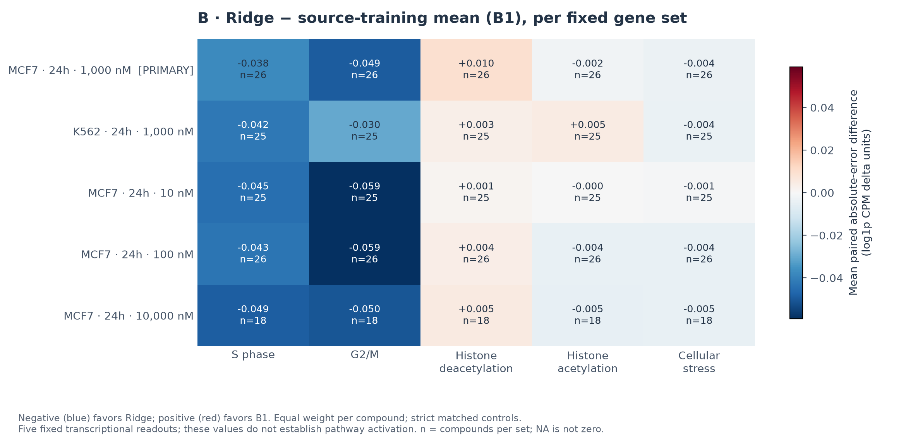
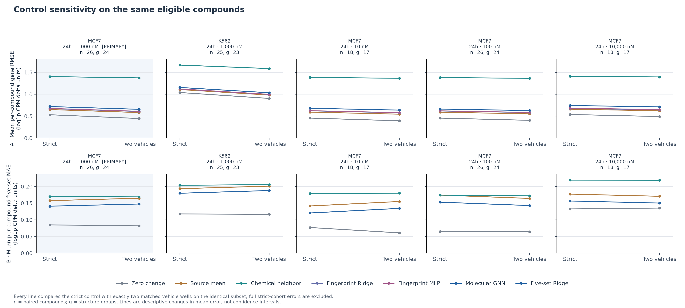

# DrugPerturb v2：A549 来源扰动预测的跨条件迁移表现有限

**在五个目标条件中，冻结的分子结构预测模型均未在平均误差上超过“零变化”基线。** 在主要测试条件 MCF7、24 小时、1 µM 下，分子图网络的基因层面误差高于分子指纹 Ridge 回归和来源训练均值。另一个直接预测五个预定义基因集合均值的模型，其点误差低于来源训练均值，但配对区间跨过零，而且仍差于零变化。本轮结果未建立这些来源预测能有效迁移到另一细胞系或剂量的证据。

这是一项已经完成、事先规定的**同一研究内部跨条件评价**，使用公开 sci-Plex3 数据。它不是独立研究验证，也不是药效研究；模型没有接收细胞类型或药物浓度。[English report](report.md) · [方法](../../docs/V2_METHODS.md) · [冻结方案](../../configs/protocol_v2.yaml)。

## 研究问题、数据与分母

来源条件为 A549、24 小时、1 µM。保留原有 119 个训练、26 个验证、26 个测试母体化合物的划分。唯一主要目标条件为 MCF7、24 小时、1 µM；K562 1 µM，以及 MCF7 10 nM、100 nM、10 µM 均为事先规定的次要条件，处理时间均为 24 小时。同一批测试药物在不同条件下重复出现，因此不能把各条件的药物数相加，当成更多独立化学样本。这些药物的 A549 响应已在 v1 中评价；新目标条件的响应没有参与开发或选择。

两个目标来源数据共保留 **438,762 个细胞核**：MCF7 为 292,010 个，K562 为 146,752 个，覆盖四个剂量、全部来源处理和 vehicle 对照。每个细胞系选择了 1,536 个实际实验孔，并保留全部 58,347 行人类基因。MCF7 有一个空孔，K562 所有孔均非空。这些是数据提取总量，**不是仅属于最终测试药物的细胞核数或孔数**。统计预测单位是具有两次实验重复的化合物，而非单个细胞核。[提取记录](../../receipts/v2_context_extraction.json)。

两个处理重复及其严格匹配对照都必须各有至少 30 个保留细胞。各条件分别应用资格标准，并要求至少 20 个药物和 10 个结构组才通过可行性门槛：

| 目标条件，均为 24 小时 | 角色 | 合格 / 原测试药物 | 结构组 | 严格对照评价 | 双 vehicle 敏感性子集 |
|---|---|---:|---:|---|---:|
| MCF7，1 µM | **主要** | 26 / 26 | 24 | 通过门槛 | 26 药物 / 24 组 |
| K562，1 µM | 次要 | 25 / 26 | 23 | 通过门槛 | 25 / 23 |
| MCF7，10 nM | 次要 | 25 / 26 | 23 | 通过门槛 | 18 / 17；仅描述 |
| MCF7，100 nM | 次要 | 26 / 26 | 24 | 通过门槛 | 26 / 24 |
| MCF7，10 µM | 次要 | 18 / 26 | 17 | **仅描述；不提供区间** | 18 / 17；仅描述 |

MCF7 10 µM 未达到药物数门槛，因此只报告误差点估计，不提供置信区间，也不放宽阈值。保留细胞数较低本身不能证明细胞毒性。10 nM 条件下，更严格的双 vehicle 规则额外排除了七个药物，原因是某个 vehicle 少于 30 个细胞。[条件状态](transfer/context_status.tsv) · [细胞数资格](context_count_qc.tsv) · [化合物排除记录](../../manifests/v2/compound_count_qc.tsv)。

## 预测值与实测值分别是什么

每个实际实验孔内的原始计数求和，再以该孔**全部人类基因**的总计数作为分母，归一化为每百万计数（CPM），随后进行 `log1p` 变换。每个重复的响应为处理孔减去严格匹配的 vehicle，最后等权平均两次重复的差值。必需基因的身份必须精确一致；缺失基因不会被补成零。

**分析 A** 将六种已封存的 v1 预测方法迁移到固定的 2,000 个输出基因。B0 预测零变化；B1 使用来源训练响应均值；B2 使用化学结构最近的训练药物响应；M1 为分子指纹 Ridge 回归；M2 为分子指纹多层感知机；M3 为分子图神经网络。神经网络沿用三次种子的冻结算术平均预测。先在每个药物的 2,000 个实测基因差值上计算均方根误差（RMSE），再对药物等权平均；这不同于把所有“药物×基因”误差混在一起后只开一次平方根。

**分析 B** 使用独立的分子指纹 Ridge 模型，直接预测五个固定基因集合的平均变化，并与相同输出空间的 B0、B1、B2 比较。仅用来源训练数据筛选后，保留 S 期 43 个、G2/M 期 54 个、组蛋白去乙酰化（HDAC）相关集合 40 个、组蛋白乙酰化（HAT）相关集合 87 个、应激反应集合 685 个基因，共 909 条集合成员关系、874 个不同基因。五个集合均通过覆盖门槛。四个 alpha 候选模型在 119 个来源训练药物上拟合，使用 26 个来源验证药物选定 alpha 100，未合并训练和验证数据重拟合。集合成员与预测均在目标评分前封存。误差先对每个药物的五个读数计算平均绝对误差（MAE），再对药物等权平均。[覆盖记录](biology_coverage.tsv) · [选择记录](../../receipts/v2_biology_selection.json) · [预测封存](../../receipts/v2_biology_prediction_seal.json)。

所有模型都只接收化学结构，因此同一药物在各目标条件中的**预测完全相同**。评价检验的是 A549 来源预测能否迁移，并不说明模型学会了细胞特异性或剂量依赖的响应。两类误差都使用 log1p CPM 差值单位，但基因 RMSE 和五集合 MAE 对应不同输出空间，不能把数值直接当成同一个终点比较。

## A：全部六种基因层面方法

下表为严格匹配对照下、药物等权的平均 RMSE，越低越好。数值保留六位小数；[汇总](transfer/summary.json)和[逐药物表](transfer/per_compound.tsv)保留完整精度。

| 条件 | 药物 / 结构组 | B0：零变化 | B1：来源均值 | B2：最近邻 | M1：Ridge | M2：MLP | M3：GNN |
|---|---:|---:|---:|---:|---:|---:|---:|
| **MCF7，1 µM——主要** | 26 / 24 | **0.532506** | 0.651318 | 1.403771 | 0.673216 | 0.676733 | 0.719755 |
| K562，1 µM | 25 / 23 | **1.039957** | 1.107726 | 1.666624 | 1.120734 | 1.121957 | 1.155189 |
| MCF7，10 nM | 25 / 23 | **0.470665** | 0.601861 | 1.382447 | 0.630400 | 0.632069 | 0.673526 |
| MCF7，100 nM | 26 / 24 | **0.456026** | 0.590424 | 1.381053 | 0.618665 | 0.621092 | 0.662230 |
| MCF7，10 µM——仅描述 | 18 / 17 | **0.538237** | 0.658578 | 1.410857 | 0.677771 | 0.683493 | 0.743217 |

零变化在每个条件下都有最低的点均值。主要条件中，GNN 误差为 0.719755，Ridge 为 0.673216，来源均值为 0.651318。结构最近训练药物的响应在五个条件中均有最高点误差；在当前迁移设计下，仅靠结构相似性未能提供准确的响应参照。

## B：全部四种五读数方法

下表为严格匹配对照下、药物等权的五集合平均 MAE，越低越好。五个输出是**基因集合读数，不是五个单独基因**。

| 条件 | 药物 / 结构组 | B0：零变化 | B1：来源均值 | B2：最近邻 | Ridge |
|---|---:|---:|---:|---:|---:|
| **MCF7，1 µM——主要** | 26 / 24 | **0.084674** | 0.157443 | 0.169654 | 0.140807 |
| K562，1 µM | 25 / 23 | **0.117593** | 0.193319 | 0.203601 | 0.179629 |
| MCF7，10 nM | 25 / 23 | **0.065556** | 0.151228 | 0.172768 | 0.130555 |
| MCF7，100 nM | 26 / 24 | **0.064506** | 0.174265 | 0.174092 | 0.152868 |
| MCF7，10 µM——仅描述 | 18 / 17 | **0.132601** | 0.177093 | 0.219082 | 0.156463 |

新 Ridge 在五个条件下的 MAE 点值均低于来源均值，但零变化始终具有最低点误差。仅仅超过来源均值，不能证明已实现有效的生物学预测。

一个次要比较具有更明确的局部改善：MCF7 100 nM 的 Ridge−来源均值差为 −0.021396，逐项 95% 区间为 [−0.040373, −0.002597]。这支持在该条件下、以该参照为比较对象的条件性改善，但 Ridge 仍差于零变化（0.152868 对 0.064506）。它不改变主要结果，也未建立经过多重比较处理的跨条件优势。

## 主要配对比较与不确定性

每个差值都在**同一药物内部**计算“候选方法误差−参考方法误差”，负值有利于候选方法。置信区间通过有放回抽取结构组生成，保留每个被抽中组的全部药物及其重复次数，每次估计仍对药物等权。共重采样 2,000 次，种子为 2026。

| 主要 MCF7 1 µM 比较；26 药物 / 24 组 | 误差差值 | 逐项 95% 区间 |
|---|---:|---:|
| A：GNN − 分子指纹 Ridge，RMSE | +0.046539 | [+0.002349, +0.104793] |
| A：GNN − 来源均值，RMSE | +0.068437 | [+0.024519, +0.127574] |
| B：五集合 Ridge − 来源均值，MAE | −0.016636 | [−0.035685, +0.003450] |

两个事先规定的基因层面区间都支持更简单的参照优于 GNN。生物学预测头的区间跨过零，其相对来源均值的点改善具有不确定性；这也不代表二者已经证明等效。这些区间以冻结模型和当前实验为条件，是逐项区间，不是经过多重比较校正的联合检验，也未涵盖重新训练的变异。零变化的最低点均值属于描述性排序，不暗示存在未报告的“对零变化”区间。[全部比较](transfer/contrasts.tsv)。

## 五个生物学读数说明了什么

主要条件的下表区分了跨 26 个药物的平均实测转录变化与平均绝对预测误差。较小的带符号平均值，可能掩盖基因之间或药物之间方向相反的响应。

| 固定读数 | 保留基因 | 平均实测差值 | 平均 Ridge 预测 | 零变化 MAE | 来源均值 MAE | Ridge MAE |
|---|---:|---:|---:|---:|---:|---:|
| S 期 | 43 | −0.112725 | −0.358207 | 0.167726 | 0.349969 | 0.312117 |
| G2/M 期 | 54 | −0.084471 | −0.277426 | 0.143728 | 0.285341 | 0.236211 |
| HDAC 相关集合 | 40 | −0.007348 | +0.021083 | 0.036465 | 0.037875 | 0.047554 |
| HAT 相关集合 | 87 | −0.025570 | −0.048935 | 0.049723 | 0.057799 | 0.055568 |
| 应激反应集合 | 685 | +0.001532 | −0.045964 | 0.025729 | 0.056231 | 0.052584 |

Ridge 和来源均值对细胞周期读数的平均预测，比 MCF7 实测值更负。相对来源均值，Ridge 将 S 期 MAE 降低 0.037852，将 G2/M MAE 降低 0.049130，但二者仍差于零变化。HDAC 相关集合的 Ridge 误差反而**增加** 0.009679；HAT 和应激读数的改善较小，分别为 0.002230 和 0.003647。因此，相对来源均值的整体点改善主要集中在细胞周期读数，而非均匀分布在五个集合上。

五个条件都呈现相同的描述性模式：Ridge 对 S 期和 G2/M 的误差低于来源均值，对 HDAC 相关集合则更高。[逐集合表](transfer/per_set.tsv)保留所有药物和基线；热图显示对药物等权的“Ridge−来源均值”绝对误差均值差。这些逐集合描述不是新增的确证性检验。

这些标签是**转录变化的均值，不是通路活性评分**。细胞周期集合变化不能证明增殖发生变化；HDAC/HAT 集合变化不测量酶抑制、乙酰化或靶点结合；应激集合均值接近零，也不能说明没有应激。集合成员重叠、相反方向的基因变化，以及药物间差异都限制机制解释。这些汇总不能支持药效结论。

## vehicle 参照的敏感性

替代响应恰好使用两个合格的同板 vehicle，分别完成归一化和变换后再平均。每个 vehicle 都必须至少有 30 个细胞，预测保持不变。下表比较的是**同一合格药物子集上的“严格对照→双 vehicle”平均误差**，绝不把完整严格队列与较小的替代队列混比。敏感性图保留全部方法。

| 条件 | 配对药物 / 组 | A：零变化 RMSE | A：GNN RMSE | B：零变化 MAE | B：Ridge MAE | B：来源均值 MAE |
|---|---:|---:|---:|---:|---:|---:|
| **MCF7，1 µM——主要** | 26 / 24 | 0.53251 → 0.44649 | 0.71975 → 0.65665 | 0.08467 → 0.08188 | 0.14081 → 0.14743 | 0.15744 → 0.16469 |
| K562，1 µM | 25 / 23 | 1.03996 → 0.90504 | 1.15519 → 1.03452 | 0.11759 → 0.11635 | 0.17963 → 0.18779 | 0.19332 → 0.20100 |
| MCF7，10 nM——仅描述子集 | 18 / 17 | 0.45655 → 0.39437 | 0.68017 → 0.63815 | 0.07686 → 0.06075 | 0.12037 → 0.13425 | 0.14142 → 0.15492 |
| MCF7，100 nM | 26 / 24 | 0.45603 → 0.40528 | 0.66223 → 0.62845 | 0.06451 → 0.06403 | 0.15287 → 0.14277 | 0.17426 → 0.16416 |
| MCF7，10 µM——仅描述 | 18 / 17 | 0.53824 → 0.49192 | 0.74322 → 0.71208 | 0.13260 → 0.13529 | 0.15646 → 0.15015 | 0.17709 → 0.17055 |

即使预测完全不变，更换参照仍会改变实测误差。例如主要条件的分析 B 中，Ridge MAE 从 0.14081 增至 0.14743，零变化 MAE 则略降。替代参照下，主要条件 GNN−Ridge 的 RMSE 差仍为正：+0.049590 [0.002346, 0.111853]；生物学 Ridge−来源均值区间仍跨零：−0.017253 [−0.036017, +0.002302]。因此主要解释保留，但响应定义对误差大小有实际影响。

MCF7 10 nM 的完整严格队列有 25 药物 / 23 组，配对敏感性子集只有 18 / 17。该子集的严格 GNN RMSE 为 0.68017，并非完整队列的 0.673526；严格五集合 Ridge MAE 为 0.12037，并非 0.130555。两种敏感性比较均未达到药物数门槛，因此没有区间。10 µM 的严格与敏感性结果同样仅作描述。[vehicle 资格](transfer/sensitivity_pairs.tsv) · [全部敏感性均值](transfer/summary.json)。

## 独立研究可行性：精确条件下的 LINCS 比较不可开展

在获取表达数据前，使用 LINCS L1000 Phase I 元数据评估独立研究可行性，要求标准化母体结构精确一致、A549、24 小时，以及**实际浓度**恰好为 1.0 µM，不能只依赖经过舍入的剂量标签。满足精确条件的签名只有三个，三者结构均成功解析，但没有任何一个匹配 26 个冻结测试药物：**0 / 26 药物、0 / 24 结构组**。固定输出基因中，当前有 **73 / 2,000 个明确、无歧义的直接实测 landmark 基因匹配**。历史别名没有穷尽解析，因此 73 不是所有可能基因映射的上界。

事先门槛为至少 20 药物、10 结构组、100 个直接实测共有基因。仅零药物交集就足以判定**该精确条件队列不可行**。未获取 LINCS Level 5 表达矩阵，也没有计算表达预测表现。这是数据兼容性结论，不是一次失败的外部准确度评价；它不说明这些药物不存在于 LINCS 的其他条件。L1000 与 sci-Plex 在平台、参照和尺度上也有差异。[可行性报告](metadata_feasibility.md) · [精确匹配记录](../../receipts/v2_external_feasibility.json)。

## 适用范围与局限

当前证据支持的是：这些固定模型、输出、药物和条件下的迁移结果不理想。零变化平均误差更低，不代表药物没有转录响应；平均过程、较小效应、异质性和所选损失函数，都可能使保守预测占优。它也不能说明所有未来模型或能够接收条件信息的方法都必然失败。

只有两次生物学重复，且存在共享 vehicle、实验板结构、基因集合重叠和跨条件重复药物，样本独立性有限。结构组重采样处理了化学分组，但不能去除所有实验依赖。高剂量排除会改变实际评价的药物组成，因此不能直接把汇总均值解释为剂量反应曲线。补充相关性和方向指标保留未定义值 NA；不能为了填表，把恒定零预测的未定义相关系数写成零。

模型在目标评分前已冻结，评价期间没有拟合新模型。完成的评价仍限定在 sci-Plex3 内部；尚未建立独立研究可重复性、靶点结合、药效或临床有效性。完整精度结果及输入输出哈希见[评价记录](../../receipts/v2_transfer_evaluation.json)、[汇总](transfer/summary.json)和[图形渲染记录](../../receipts/v2_transfer_rendering.json)。

[公开预测复跑](../../receipts/v2_public_replay.json) 在独立的公开源码副本中，使用已发布预测和已核验的派生计数，在没有私有模型权重的情况下逐字节重现了全部六份科学结果。[本地验证](../../receipts/v2_validation.json) 通过 330 项 Python 测试。这些属于计算检查；本次复跑没有重新提取原始数据，也没有重新验证模型训练。
